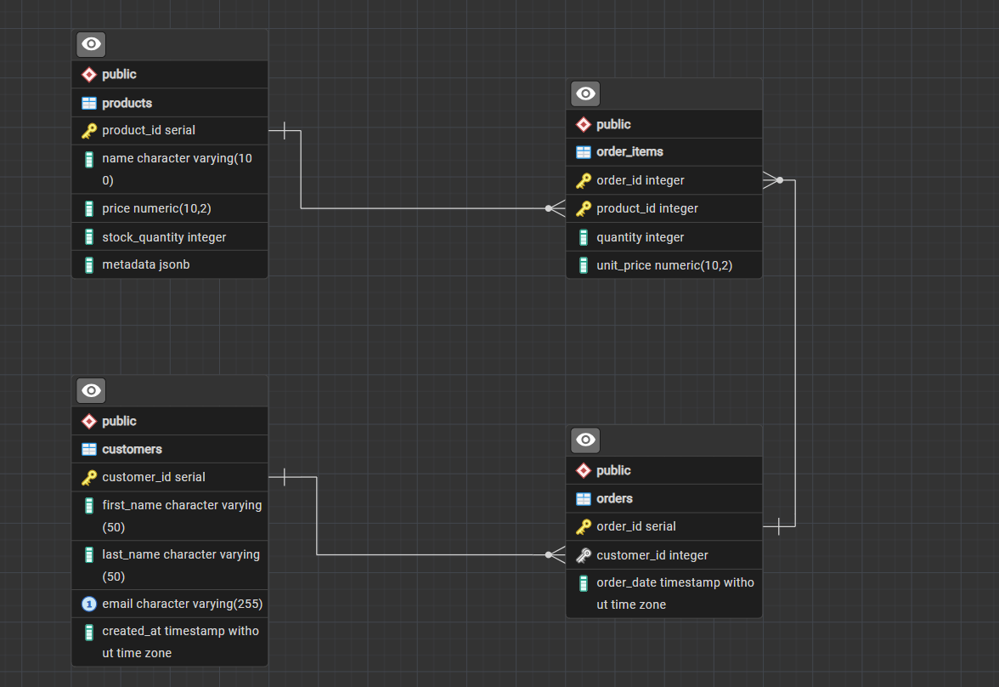

# E-Commerce Analytics Data Pipeline

A data processing and analytics pipeline for a fictional e-commerce store, using
PostgreSQL (with JSONB), Redis and MongoDB from Python.


## Setup

Requirements: Python 3.11+ and Docker.

```bash
docker compose up -d
python -m venv .venv
.venv\Scripts\activate        # Windows (use source .venv/bin/activate on Linux/macOS)
pip install -r requirements.txt
python src/create_tables.py
```

Load the sample data:

```bash
# Bash
docker compose exec -T postgres psql -U ecommerce < sql/sample_data.sql
# PowerShell
Get-Content sql\sample_data.sql -Raw | docker compose exec -T postgres psql -U ecommerce
```

Run the tests (all commands are run from the project root):

```bash
python -m pytest -v
```

The tests use a separate `ecommerce_test` database that is dropped and recreated on
each run, so the main data is not affected. They cover the CRUD functions, the
transaction rollback, the Redis cache and the MongoDB cart.

Run the analytical queries and the optimization steps in a client such as pgAdmin
(connect to `localhost:5433`), or with psql:

```bash
docker compose exec -T postgres psql -U ecommerce < sql/queries.sql
docker compose exec -T postgres psql -U ecommerce < sql/optimization.sql
```

PostgreSQL is exposed on host port **5433** (user, password and database: `ecommerce`).
Redis runs on 6379 and MongoDB on 27017. Connection settings can be overridden with
the `POSTGRES_HOST`, `POSTGRES_PORT`, `POSTGRES_DB`, `POSTGRES_USER`,
`POSTGRES_PASSWORD`, `REDIS_HOST`, `REDIS_PORT` and `MONGO_URI` environment variables.

## Project Structure

| File | Purpose |
|---|---|
| `docker-compose.yml` | PostgreSQL, Redis and MongoDB containers |
| `sql/schema.sql` | DDL for the four tables |
| `sql/sample_data.sql` | Sample data: 5,000 customers, 50,000 products, 50,000 orders, ~125,000 order items |
| `sql/queries.sql` | Analytical queries: `RANK()`, CTE and JSONB |
| `sql/optimization.sql` | `EXPLAIN ANALYZE` steps before and after adding indexes |
| `src/create_tables.py` | Creates the tables by running `schema.sql` |
| `src/db.py` | Connection pool and the functions `add_product()`, `create_order()`, `get_customer_orders()` and `get_top_selling_products()` |
| `src/cache.py` | Redis cache for the top 10 best-selling products |
| `src/sessions.py` | MongoDB session and cart data |
| `tests/` | pytest tests (`pytest.ini` adds `src` to the import path) |
| `docs/er_diagram.png` | ER diagram |

## Python and Database Integration

- **Connection pooling:** `db.py` creates one `psycopg2` `SimpleConnectionPool`. The
  `get_cursor()` helper takes a connection from the pool, runs the block as one
  transaction (commit on success, rollback on error) and returns the connection.
- **SQL injection:** all values are passed as query parameters (`%s`), never
  formatted into the SQL string.
- **Transactions:** `create_order()` inserts the order, locks each product row
  (`SELECT ... FOR UPDATE`), checks and reduces stock, and inserts the order items in
  one transaction. If any item fails (unknown product or not enough stock), the whole
  order is rolled back.
- **Redis:** `get_top_selling_products()` returns the top 10 products by quantity sold
  from Redis if they are cached. Otherwise it queries PostgreSQL and caches the result.
  `create_order()` deletes the cached list, because a new order changes the totals.
- **MongoDB:** each customer has one document in `ecommerce.sessions` holding their
  cart, `{customer_id, cart: [{product_id, quantity}], last_active}`. Adding a product
  that is already in the cart increases its quantity.
- **JSONB:** product attributes are stored in `products.metadata` and queried with the
  containment operator `@>` (see `sql/queries.sql`).

## Analytical Queries

[sql/queries.sql](sql/queries.sql) contains:

1. **Product ranking:** revenue per product ranked with `RANK() OVER (ORDER BY ...)`.
   Products with equal revenue get the same rank.
2. **Revenue per customer:** a CTE (`WITH customer_revenue AS ...`) totals each
   customer's orders and revenue, and the main query joins it to `customers` to list
   the top 10.
3. **JSONB metadata:** products available in red and products available in size XL,
   using `@>`, with `->` to extract the sizes.

## ER Diagram



## Schema

The DDL is in [sql/schema.sql](sql/schema.sql).

| Table | Purpose | Keys and constraints |
|---|---|---|
| `customers` | Store customers | PK `customer_id`, `email` is unique |
| `products` | Product catalog, with flexible attributes (sizes, colors) in a `metadata` JSONB column | PK `product_id`, `price >= 0`, `stock_quantity >= 0` |
| `orders` | One row per order placed by a customer | PK `order_id`, FK `customer_id` → `customers` |
| `order_items` | The products in each order | PK (`order_id`, `product_id`), FKs to `orders` and `products`, `quantity > 0`, `unit_price >= 0` |

Relationships: a customer has many orders, and an order has many order items. Each
order item refers to one product, so `order_items` resolves the many-to-many
relationship between orders and products.

### Normalization decisions (3NF)

- **1NF:** every column holds a single value. The products in an order are stored as
  separate rows in `order_items`, not as a list in `orders`.
- **2NF:** in `order_items` (composite key `order_id`, `product_id`), `quantity` and
  `unit_price` depend on the whole key. Product details such as `name` stay in
  `products`, because they depend only on `product_id`.
- **3NF:** no non-key column depends on another non-key column. Customer details live
  only in `customers`, and `orders` references them by `customer_id`.
- **No stored order total:** the total is derived from `order_items`
  (`SUM(quantity * unit_price)`), so it can never get out of sync.
- **`unit_price` in `order_items`:** this is the price at the time of purchase, not a
  copy of `products.price`. It keeps past orders correct when a product's price
  changes.
- **`metadata` JSONB:** product attributes vary by product, for example sizes for
  shirts or colors for phones. They are kept in one JSONB column instead of sparse
  columns, as the project requires.

## Optimization Report

The steps are in [sql/optimization.sql](sql/optimization.sql) and were run with
`EXPLAIN ANALYZE` on the sample data (5,000 customers, 50,000 products, 50,000 orders,
~125,000 order items), first without any extra index and then with it.

### B-tree index on `orders.customer_id`

Query: the orders and totals of one customer (the query behind `get_customer_orders()`).

| | Plan on `orders` | Rows read and discarded | Execution time |
|---|---|---|---|
| Before | `Seq Scan` | 49,988 | 4.402 ms |
| After `CREATE INDEX idx_orders_customer_id` | `Bitmap Index Scan` on the new index | 0 | 0.656 ms |

The query became about **6.7× faster** (the orders lookup alone went from 3.8 ms to
0.16 ms). PostgreSQL does not index foreign key columns automatically, so without
the index it had to read all 50,000 orders to find the 12 that belong to the customer.
The join to `order_items` already used the `order_items_pkey` index, because the
composite primary key starts with `order_id`.

### GIN index on `products.metadata`

Query: products available in red, `WHERE metadata @> '{"colors": ["red"]}'`.

| | Plan on `products` | Rows read and discarded | Execution time |
|---|---|---|---|
| Before | `Seq Scan` | 35,728 | ~14.4 ms |
| After `CREATE INDEX idx_products_metadata ... USING GIN` | `Bitmap Index Scan` on the new index | 0 | 11.645 ms |

The GIN index lets PostgreSQL find matching products without checking every row's
JSON, but the gain here is modest (about 20%) because the filter is not selective:
about 29% of all products (14,272) are red, and every one of them still has to be
read from the table. GIN indexes pay off most on selective filters. For example,
`{"colors": ["red", "yellow"], "sizes": ["XS"]}` (1,920 matches) ran in about 4 ms
with the index.

With only 200 products PostgreSQL ignored the GIN index entirely (a sequential scan
of so few rows is cheaper), which is why the sample data uses 50,000 products.
